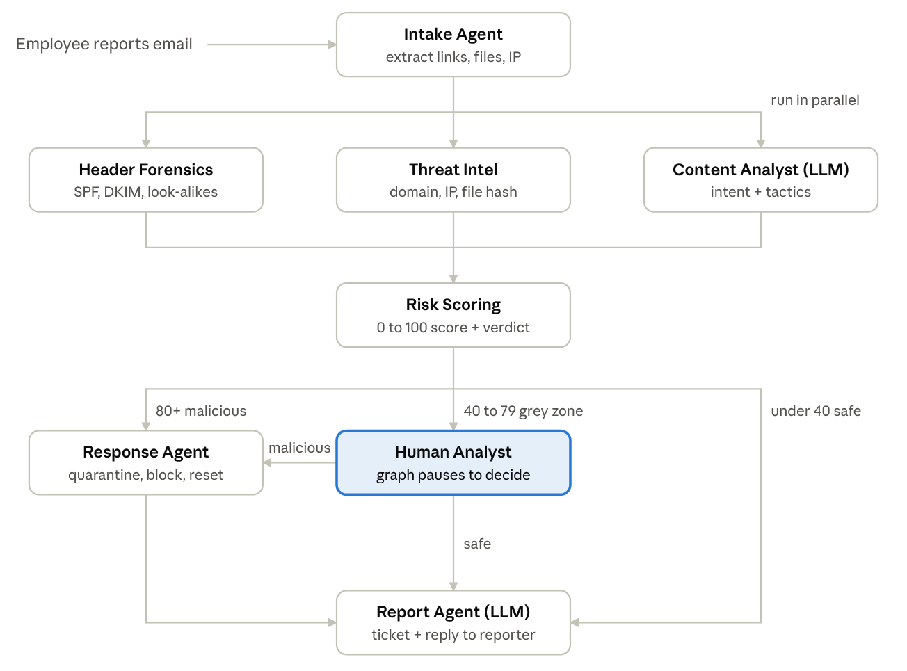

# PhishHunter - Agentic Phishing Triage (FAAI CA-3 PoC)

A multi-agent system built with **LangGraph** that investigates emails employees report as
phishing, scores the risk, and contains real attacks automatically. Grey-zone cases pause for a
human analyst. Everything runs on **dummy data** in `data/`.

## Submission contents
| Item | Location |
|---|---|
| Presentation (PPT) | [`docs/PhishHunter_Presentation.pptx`](docs/PhishHunter_Presentation.pptx) |
| Report (Docx): problem statement, workflow, agents, results | [`docs/PhishHunter_Report.docx`](docs/PhishHunter_Report.docx) |
| Codebase | this folder (`graph.py`, `tools.py`, `llm.py`, `app.py`, `run_cli.py`, `data/`) |



## Agents
1. **Intake** - extracts sender, links (expands short links), attachments, IP
2. **Header Forensics** - SPF/DKIM/DMARC, Reply-To mismatch, CEO/internal impersonation, look-alike domains  *(parallel)*
3. **Threat Intel** - domain / IP / file-hash reputation, domain age, double extensions  *(parallel)*
4. **Content Analyst (LLM)** - intent + social-engineering tactics  *(parallel)*
5. **Risk Scoring** - sums signal points into 0-100, sets verdict, routes
6. **Human Analyst** - LangGraph `interrupt()` for scores 40-79
7. **Response** - blast radius, clicks, quarantine / block / reset / isolate / hold payment, ticket
8. **Report (LLM)** - incident summary + reply to the reporter

Routing: **80+** auto-contain - **40-79** human review - **under 40** close as safe.

## Run it
```bash
pip install -r requirements.txt
streamlit run app.py          # web demo
python run_cli.py             # terminal: all emails (asks you on grey-zone ones)
python run_cli.py --auto      # terminal: no questions
python run_cli.py E5          # one email
```

### LLM (optional)
Get a free Gemini key at https://aistudio.google.com/apikey and either paste it in the app sidebar
or set `GOOGLE_API_KEY`. Without a key (or if the internet/quota fails) the agents switch to
**offline rule-based mode** automatically, so the demo always works.
Change the model with `GEMINI_MODEL` (default `gemini-2.5-flash`).

## Files
| File | What it is |
|---|---|
| `graph.py` | State, 8 agents, routing, human interrupt, graph |
| `tools.py` | Tools over the dummy data (lookups, mailbox search, response actions) |
| `llm.py` | Gemini wrapper with offline fallback |
| `app.py` | Streamlit UI (triage view + SOC dashboard) |
| `run_cli.py` | Terminal runner |
| `data/emails.json` | 7 reported emails |
| `data/threat_intel.json` | Dummy threat-intel feed |
| `data/org_context.json` | Company, executives, vendors, delivery log, click log |

## Demo script (5 min)
1. **E1** (M365 password phishing) -> score 100, auto-contained, 14 mailboxes, 1 password reset
2. **E5** (vendor bank change) -> score 65, passes SPF/DKIM/DMARC, pauses -> click *Confirm MALICIOUS* -> PO-4471 held
3. **E7** (LinkedIn) -> score 0, closed as safe
4. Optional: *SOC dashboard* tab -> *Triage all reported emails*
